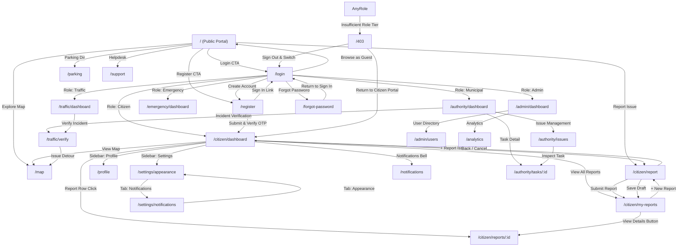
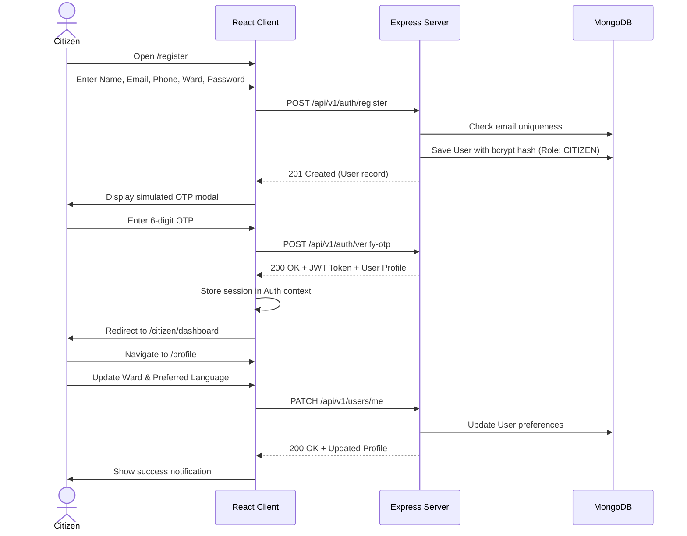
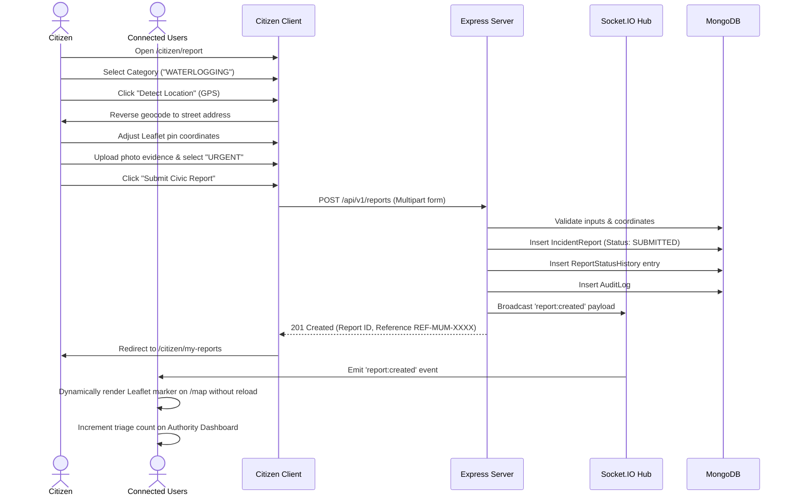
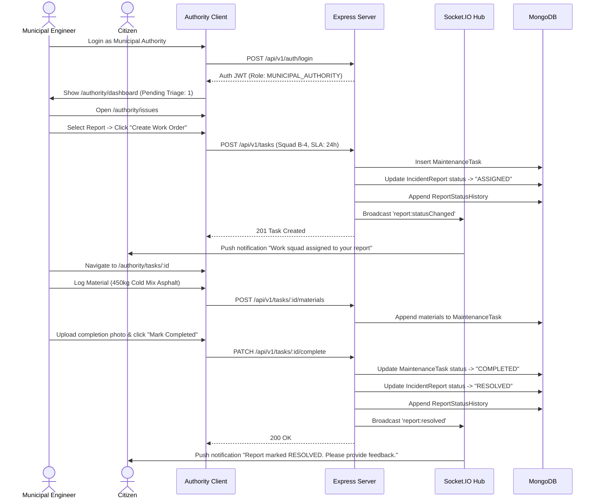
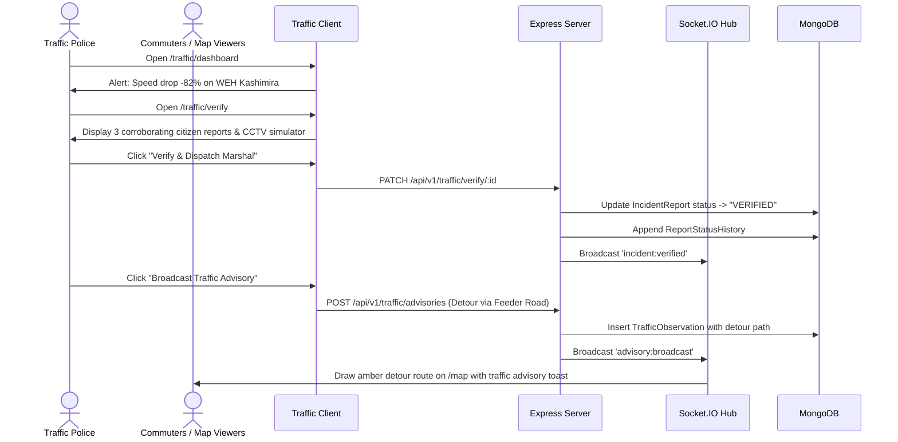
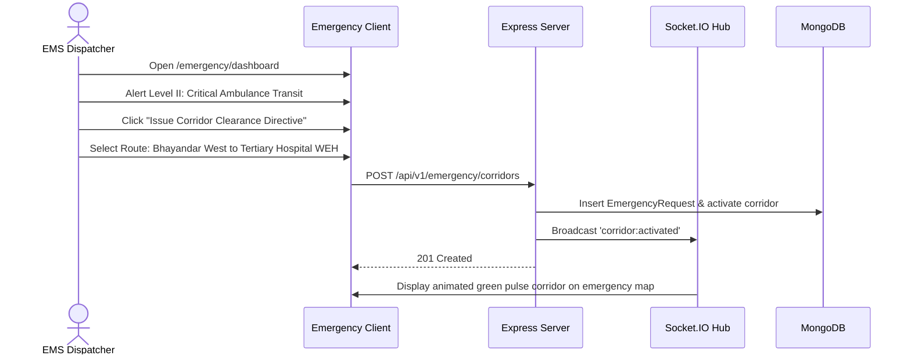
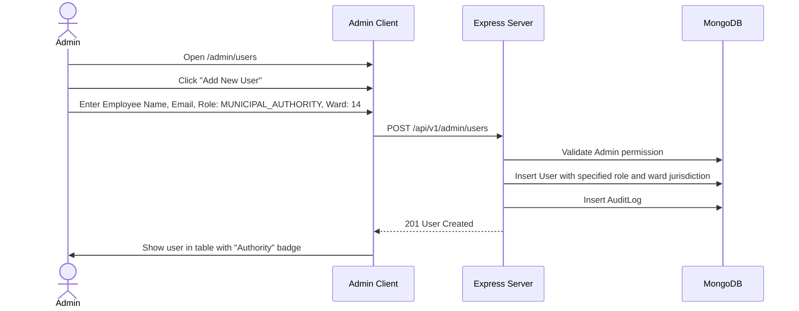
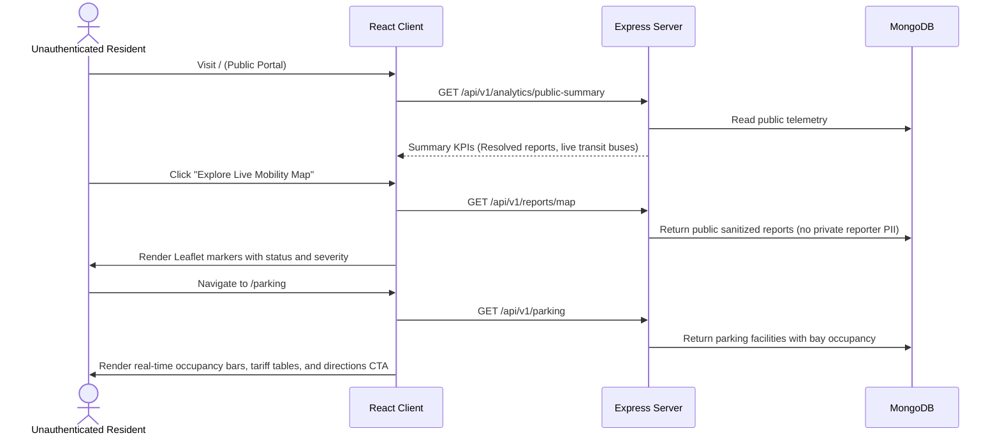

# Stitch Urban Mobility Coordination Platform (UMCP) — User Flows & Journeys

## 1. Overview & Role Model

The UMCP platform coordinates actions across five canonical roles:
1. `CITIZEN`: Public resident submitting hazards, reviewing status, exploring parking and transit.
2. `MUNICIPAL_AUTHORITY`: Municipal engineers and maintenance supervisors triaging reports, dispatching repair squads, and completing work orders.
3. `TRAFFIC_AUTHORITY`: Traffic police coordinating incident verification, CCTV review, and public route advisories.
4. `EMERGENCY_SERVICE`: Dispatchers managing green corridor directives and emergency hospital routes.
5. `ADMIN`: System administrators governing user provisioning, system health, and audit logs.

---

## 2. Master Navigation & Route Flowchart

---

## 3. End-to-End User Journeys

### 3.1 Citizen Registration, Authentication & Profile Management

---

### 3.2 Citizen Hazard Reporting, Map Synchronization & Real-time Tracking

---

### 3.3 Municipal Authority Triage & Maintenance Sign-off

---

### 3.4 Traffic Incident Verification & Route Advisory Broadcast

---

### 3.5 Emergency Services Green Corridor Directive

---

### 3.6 Platform Administrator User & Role Governance

---

### 3.7 Public Discovery & Smart Parking Exploration

